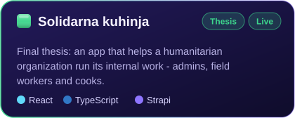
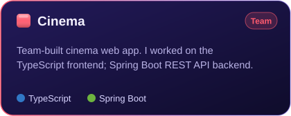
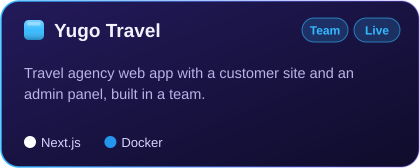
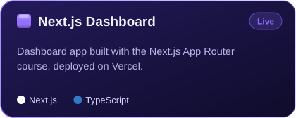
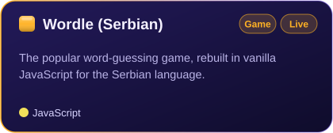
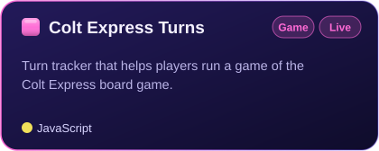

 

<h3></h3>

✦ **Frontend / full-stack developer** from Serbia 
✦ Building web apps with **React, Next.js and TypeScript** 
✦ Backend work in **C# / .NET**, plus some PHP along the way 
✦ Final thesis: **[Solidarna kuhinja](https://solidarity-kitchen.vercel.app/)**, a management app for a solidarity kitchen 
✦ Team player: built a **cinema app** and a **travel agency platform** with other developers 
✦ Making **games** for web and mobile in my free time 🎮

<h3></h3>

<h3></h3>

  
  
  
  
  
  

Code: [solidarna-kuhinja](https://github.com/Zavrsni-rad-ict/solidarna-kuhinja) · [cinema-frontend](https://github.com/reddit-programatori/cinema-frontend) / [cinema-backend](https://github.com/reddit-programatori/cinema-backend) · Yugo Travel [client](https://yugo-travel-fe-client.vercel.app) / [admin](https://yugo-travel-fe-admin.vercel.app) (private repo) · [nextjs-dashboard](https://github.com/vanja-veapi/nextjs-dashboard) · [wordle](https://github.com/vanja-veapi/wordle) · [colt-express-turn-manager](https://github.com/vanja-veapi/colt-express-turn-manager)

<h3></h3>

<b>🎮 Games & fun</b>

| Project | Description | |
|---|---|---|
| [YuGiOhLPCounter](https://github.com/vanja-veapi/YuGiOhLPCounter) | Life-point counter for Yu-Gi-Oh! duels (React Native / Expo) | |
| [un-fortune-cookie](https://github.com/vanja-veapi/un-fortune-cookie) | Shareable (un)fortune cookie generator | [▶ Open](https://vanja-veapi.github.io/un-fortune-cookie/) |
| [speed-writing](https://github.com/vanja-veapi/speed-writing) | Typing speed game | [▶ Play](https://vanja-veapi.github.io/speed-writing/) |
| [canvas-paint](https://github.com/vanja-veapi/canvas-paint) | Mini paint app on HTML canvas | [▶ Open](https://vanja-veapi.github.io/canvas-paint/) |

<b>🌐 Web apps</b>

| Project | Description | |
|---|---|---|
| [CameraShop](https://github.com/vanja-veapi/CameraShop) | Camera web shop (C# / .NET) | |
| [react-hr-app](https://github.com/vanja-veapi/react-hr-app) | HR management app in React | |
| [q-project-info](https://github.com/vanja-veapi/q-project-info) | Project info app (React) | [▶ Open](https://q-project-info.vercel.app) |
| [photo-store](https://github.com/vanja-veapi/photo-store) | E-commerce project for university | [▶ Open](https://vanja-veapi.github.io/photo-store/) |
| [youtube-api](https://github.com/vanja-veapi/youtube-api) | Video browser using the YouTube API | [▶ Open](https://vanja-veapi.github.io/youtube-api/) |
| [BeerShopAJAX](https://github.com/vanja-veapi/BeerShopAJAX) · [beer-shop-recoded](https://github.com/vanja-veapi/beer-shop-recoded) | Beer shop with AJAX + rewritten version | [▶ Open](https://vanja-veapi.github.io/beer-shop-recoded/) |
| [bre-prodavnica](https://github.com/vanja-veapi/bre-prodavnica) · [prodavnica-php](https://github.com/vanja-veapi/prodavnica-php) | T-shirt shop in PHP | |

<b>🧰 Small tools</b>

| Project | Description | |
|---|---|---|
| [CMD-Scripts](https://github.com/vanja-veapi/CMD-Scripts) | Handy Windows batch scripts | |
| [js-contacts](https://github.com/vanja-veapi/js-contacts) | Contact book (names + phone numbers) | [▶ Open](https://vanja-veapi.github.io/js-contacts/) |
| [rezultat-semafor](https://github.com/vanja-veapi/rezultat-semafor) | Basketball scoreboard with game clock | [▶ Open](https://vanja-veapi.github.io/rezultat-semafor/) |
| [tip-calculator](https://github.com/vanja-veapi/tip-calculator) | Tip calculator | [▶ Open](https://vanja-veapi.github.io/tip-calculator/) |
| [tap-counter](https://github.com/vanja-veapi/tap-counter) | Simple tap counter | |
| [Stopwatch-apk](https://github.com/vanja-veapi/Stopwatch-apk) | Stopwatch app in C# | |

<b>📚 Learning</b>

- [web-bootcamp](https://github.com/vanja-veapi/web-bootcamp) – all weekly bootcamp assignments in one repo
- [frontend-bites](https://github.com/vanja-veapi/frontend-bites) – small frontend experiments
- [JavaScript1](https://github.com/vanja-veapi/JavaScript1) · [Responsive-web-design](https://github.com/vanja-veapi/Responsive-web-design) · [HTML-CSS-JavaScript-Bootstrap-AJAX-and-JSON](https://github.com/vanja-veapi/HTML-CSS-JavaScript-Bootstrap-AJAX-and-JSON) · [portfolio](https://github.com/vanja-veapi/portfolio) – early college projects

<h3></h3>

